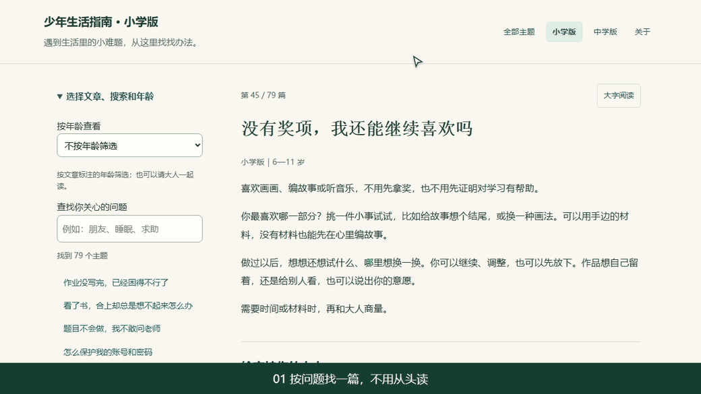

<div align="center">

# 少年生活指南

**遇到生活里的小难题，从这里找找办法。**

面向 6—17 岁孩子及支持他们的大人。聊学习、朋友、情绪、兴趣和日常选择，<br>
也给孩子留出自己判断、试一试、再调整的空间。

[](docs/主题目录.md)
[](#怎么读)
[](#怎么读)
[](docs/agent使用说明.md)
[](#许可与署名)

### [打开在线阅读](https://marcell-lee.github.io/youth-life-guide/) · [让 AI 帮你查](docs/agent使用说明.md)

<a href="https://marcell-lee.github.io/youth-life-guide/"></a>

<sub>真实页面演示：按问题搜索 → 选择分龄稿 → 交给 AI。</sub>

</div>

| 想做什么 | 从这里开始 |
|---|---|
| **在线读** | [综合版](https://marcell-lee.github.io/youth-life-guide/) · [小学版](https://marcell-lee.github.io/youth-life-guide/小学版-离线试读.html) · [中学版](https://marcell-lee.github.io/youth-life-guide/中学版-离线试读.html) |
| **下载** | [最新版阅读包与技能包](https://github.com/Marcell-Lee/youth-life-guide/releases/latest) · [发布记录](https://github.com/Marcell-Lee/youth-life-guide/releases) |
| **查阅** | [83 个主题目录](docs/主题目录.md) · [静态阅读](https://marcell-lee.github.io/youth-life-guide/read/index.html) · [按问题找文章](#这本书想回答的问题) · [怎么读](#怎么读) |
| **交给 AI** | [使用与安装](docs/agent使用说明.md) · [技能文件](skills/youth-life-guide/SKILL.md) · [机器可读目录](https://marcell-lee.github.io/youth-life-guide/agent/index.json) |
| **核对依据** | 每篇末尾点“查看本篇依据与核查”；[源码目录](docs/主题目录.md)也列出每题的依据卡 |
| **反馈与参与** | [指出问题或提建议](https://github.com/Marcell-Lee/youth-life-guide/issues) · [查看正文源码](topics/) |

## 这本书想回答的问题

先选和眼前处境贴近的问题。表里列的是一些常见入口，全部篇章见[主题目录](docs/主题目录.md)。

| 问题 | 去哪看 |
|---|---|
| 作业还没写完，已经很困了；任务一多，就不知道从哪里开始？ | [作业与休息](https://marcell-lee.github.io/youth-life-guide/#K001) · [开始第一小步](https://marcell-lee.github.io/youth-life-guide/#K036) |
| 总是重看书却记不住，复习也全挤在最后一天，怎么调整？ | [为什么想不起来](https://marcell-lee.github.io/youth-life-guide/#K037) · [安排复习](https://marcell-lee.github.io/youth-life-guide/#K038) |
| 考差了就否定自己，生气、难受的时候又说不清？ | [一次考试不定义自己](https://marcell-lee.github.io/youth-life-guide/#K013) · [说清感受](https://marcell-lee.github.io/youth-life-guide/#K011) |
| 想交朋友却不知道怎么开始；朋友让我做不愿意做的事，怎么说？ | [开始交朋友](https://marcell-lee.github.io/youth-life-guide/#K021) · [表达不愿意](https://marcell-lee.github.io/youth-life-guide/#K023) |
| 和朋友吵架、没被邀请，或者遭到排斥和伤害，我可以怎么办？ | [还要不要和好](https://marcell-lee.github.io/youth-life-guide/#K022) · [没被邀请](https://marcell-lee.github.io/youth-life-guide/#K024) · [遇到欺负](https://marcell-lee.github.io/youth-life-guide/#K026) |
| 我想要一点隐私，也想参与家里和学校的决定，怎样说出意见？ | [隐私怎么谈](https://marcell-lee.github.io/youth-life-guide/#K032) · [参与决定](https://marcell-lee.github.io/youth-life-guide/#K067) |
| 家长想把选择权慢慢交给孩子，可以先从哪些日常小事开始？ | [先听孩子的意见](https://marcell-lee.github.io/youth-life-guide/#K067) · [一起商量游戏时间](https://marcell-lee.github.io/youth-life-guide/#K050) |
| 喜欢画画、音乐或编故事，没有奖项也值得继续吗？休息时总内疚怎么办？ | [兴趣不只看奖项](https://marcell-lee.github.io/youth-life-guide/#K043) · [玩耍与休息](https://marcell-lee.github.io/youth-life-guide/#K041) |
| 玩手机总被催停，推荐内容越刷越难受，我能调整什么？ | [商量手机时间](https://marcell-lee.github.io/youth-life-guide/#K050) · [调整推荐内容](https://marcell-lee.github.io/youth-life-guide/#K049) |
| AI 的答案和网上的消息可信吗？怎样保护账号和个人信息？ | [判断信息](https://marcell-lee.github.io/youth-life-guide/#K048) · [保护账号](https://marcell-lee.github.io/youth-life-guide/#K046) |
| 朋友都买了，我也一定要买吗？零花钱怎么安排，买错了又怎么办？ | [要不要跟着买](https://marcell-lee.github.io/youth-life-guide/#K051) · [安排零花钱](https://marcell-lee.github.io/youth-life-guide/#K052) · [冲动消费之后](https://marcell-lee.github.io/youth-life-guide/#K053) |
| 身体发育和同学不一样，或被人评价长相、胖瘦，怎么面对？ | [身体变化](https://marcell-lee.github.io/youth-life-guide/#K006) · [别人评价我的身体](https://marcell-lee.github.io/youth-life-guide/#K009) |
| 不想被拥抱、亲吻或逗弄，可以拒绝吗？有人让我保守身体秘密呢？ | [说出身体边界](https://marcell-lee.github.io/youth-life-guide/#K056) · [分辨身体秘密](https://marcell-lee.github.io/youth-life-guide/#K057) |
| 没钱、没手机，或学习和活动需要不同的支持，还有哪些办法？ | [没有手机时](https://marcell-lee.github.io/youth-life-guide/#K071) · [表达支持需要](https://marcell-lee.github.io/youth-life-guide/#K072) |
| 还不知道将来想做什么，怎样先试一项技能、学一点独立生活的本领？ | [不必急着定方向](https://marcell-lee.github.io/youth-life-guide/#K076) · [低成本试技能](https://marcell-lee.github.io/youth-life-guide/#K077) · [生活技能从哪件开始](https://marcell-lee.github.io/youth-life-guide/#K080) |

## 怎么读

- **先看眼前的问题。** 不用从头读完。在网页里搜“朋友”“作业”“手机”这样的词，挑一两篇有用的，先试一个自己愿意做的小步骤。
- **小学和中学分开选。** 进入[小学版](https://marcell-lee.github.io/youth-life-guide/小学版-离线试读.html)或[中学版](https://marcell-lee.github.io/youth-life-guide/中学版-离线试读.html)，参考稿件的年龄与共读提示。综合版按读者展开段落，成人说明可以需要时再看。
- **孩子可以有自己的想法。** 看完后想一想：哪种做法更适合我？我想先试什么？试过以后，可以继续、调整，也可以先停一停。
- **大人可以看每篇的成人部分。** 先听孩子怎么看，再商量时间、费用和边界。把适合孩子做的决定留给他，需要成人承担的照护和保护由成人负责。
- **想核对就展开依据。** 每篇末尾的“查看本篇依据与核查”列出来源、编辑建议和未决项。也可以从[源码主题目录](docs/主题目录.md)直接读依据卡。
- **想让 AI 帮你找。** 打开阅读工具中的“交给 AI”，复制提示，补上问题；也可以[安装技能](docs/agent使用说明.md)。AI 应先读正文，再按年龄回答，并给出篇章出处。
- **想离线读。** 下载[最新阅读包](https://github.com/Marcell-Lee/youth-life-guide/releases/latest)，解压后打开 `site/index.html`。不使用 JavaScript 时可以打开 `site/read/index.html`。保存下来的版本不会自动更新，更新内容可以回到在线版查看。

<details>
<summary>版本范围与内容说明</summary>

现有 83 个主题、83 篇综合正文、79 篇小学稿、83 篇中学稿，每题附依据与核查。K058、K059、K078、K079 暂无小学稿，不将中学稿直接当作小学稿。

内容由 AI 辅助整理，尚未完成专业审阅及儿童试读。依据中分别保留来源、编辑判断和未决项；年龄标注与格式检查不代表专业适龄确认。

</details>


## 给 Agent 使用

把下面这段和你的问题一起发给支持读取网页的 AI：

> 请读取并使用 https://raw.githubusercontent.com/Marcell-Lee/youth-life-guide/main/skills/youth-life-guide/SKILL.md 。若不能安装，请在当前对话使用。先查相关正文与依据，按年龄回答，附主题出处和阅读链接。我的问题是：……

技能名称是 `youth-life-guide`。可以将 `skills/youth-life-guide/` 复制到 agent 支持的技能目录；本仓库内的使用入口在 [AGENTS.md](AGENTS.md)。无需密钥、后台或 MCP 服务。

在线资料：[主题目录 Markdown](https://marcell-lee.github.io/youth-life-guide/agent/index.md) · [目录 JSON](https://marcell-lee.github.io/youth-life-guide/agent/index.json) · [版本与文件哈希](https://marcell-lee.github.io/youth-life-guide/agent/manifest.json)。

本地正文在 `topics/K编号/`，可从[源码主题目录](docs/主题目录.md)定位。先搜索相关主题，再完整读取所选年龄版本及 `依据与核查.md`，无需一次加载整本书。

## 本地构建与检查

需要 Node.js 22 或以上、npm 和 Git。公开网站及 agent 资料只需 Node.js，不需要 Python。

```sh
npm ci
npm run build
npm run preview
```

打开 `http://127.0.0.1:4173`。生成目录是 `dist/site/`，源码和构建产物分开维护。

```sh
npx playwright install chromium
npm test
```

提交到 main 后，GitHub Actions 检查正文、链接、哈希及桌面／手机阅读，再发布 GitHub Pages。旧阅读文件名和 `#K编号` 链接保持可用。

## 项目结构

```text
topics/       唯一正文来源：综合、小学、中学、依据
metadata/     稿件标注的年龄数据
skills/       可独立安装的 Agent 技能
build/        阅读网站、Agent 资源的构建与检查
docs/         使用与维护说明
```

作者的本地批注和内部工作目录不公开，也不是技能的数据来源。改文章时直接改 `topics/`，不要改生成文件；标题或可用版本改变后运行 `npm run catalog` 更新源码目录，测试会检查是否同步。欢迎通过 Issue 或 PR 指出具体主题和改进理由；请勿提交孩子的真实姓名、学校、住址或批注中的个人资料。

## 许可与署名

代码、构建工具与技能说明采用 [MIT](LICENSE)。`topics/` 原创正文、年龄数据和由其生成的阅读及 agent 内容采用 [CC BY 4.0](LICENSE-CONTENT)。第三方引文与外部资料保留各自权利，不因被引用而改变许可。

转载或改编正文请注明：**少年生活指南项目贡献者**，附[原项目链接](https://github.com/Marcell-Lee/youth-life-guide)和 [CC BY 4.0 许可](https://creativecommons.org/licenses/by/4.0/)，并说明修改。署名不表示原作者认可改编内容。

Agent 的检索与引用工作流参考 [HowToLiveBetter](https://github.com/eternity4719/HowToLiveBetter/tree/main/skills/life-decision-guide)；本项目技能与正文独立编写。
